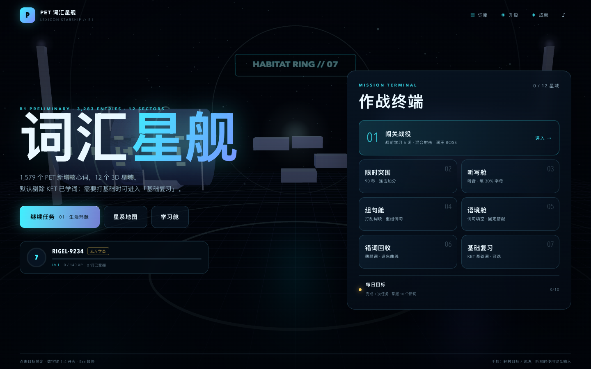
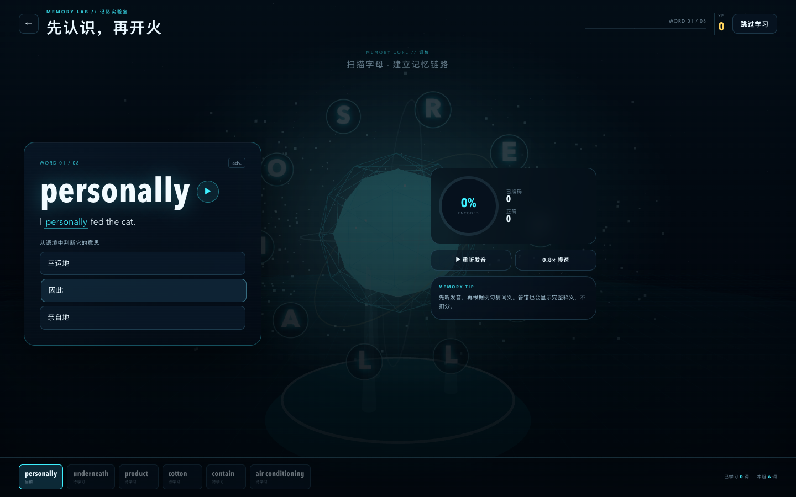

# PET 词汇星舰 · Lexicon Starship

一个可以直接在浏览器 / 手机上玩的 **3D PET 词汇闯关游戏**。  
先进入「记忆实验室」用 **3D 词核 + 语境猜义 + 记忆链路** 学 6 个词，再带着刚学的词进入 **射击识词、听写填空、语境选择、语序重构** 战场；12 个程序化 3D 星域、舰员等级、模块升级和词王 BOSS 串成完整闯关线。

**在线试玩**：<https://backyes.github.io/pet-vocab-starship/>  
**卡牌小游戏「词花令」**：<https://backyes.github.io/pet-vocab-starship/ink-cards/>





## 现在有什么

| 模块 | 内容 |
| --- | --- |
| 词库规模 | **3,283 个词条**：1,579 个 PET 新增核心 + 1,704 个 KET 基础词（默认封存） |
| 例句 | 3,131 条英文语境例句；2,650+ 条可进行组句/填空 |
| 发音 | 3,283 条英式发音（PET/KET 词卡原声 + 补录），支持 0.8× 慢速 |
| 星域 | 12 个主题、12 套程序化 3D 场景：生活环舱、霓虹夜市、跃迁港湾、轨道学院、零号医疗舱、翡翠穹顶、极光心海、数据矩阵、零重力竞技场、霓虹都市、星环艺术馆、羁绊花园 |
| 学习 | 3D 记忆实验室：词核、字母光环、语境猜义、记忆链路配对、战前学习 6 词 |
| 玩法 | 闯关战役 / 学习舱 / 限时突围 / 听写舱 / 组句舱 / 语境舱 / 错词回收 / 基础复习 |
| 成长 | 舰员 ID、等级、军衔、经验、模块点、6 个可升级舰载模块、12 个成就、12 星域解锁、词王 BOSS |
| 学习 | 正确率、连击、掌握度、错词本、按遗忘曲线加权的抽词、词库搜索与筛选 |
| 手机 | 响应式竖屏/横屏、触屏目标、听写软键盘适配、PWA 可添加到主屏幕 |
| 词花令 | 独立的水墨卡牌小游戏 `ink-cards/`：掌风拍卡 · 词笺翻面 · 花令双倍 · 墨掌柜对战 |

> **关于 KET**：按你的要求，默认的「闯关战役」和训练抽词**剔除 KET 基础词**。  
> 词库里 KET 词保留为「基础复习」可选项，默认不显示；如果你只想看 PET 新增词，词库默认筛选就是 `PET 新增`。

## 快速开始

### 电脑

```bash
cd pet-vocab-starship
python3 -m http.server 8000
# 浏览器打开 http://localhost:8000
# 水墨卡牌小游戏：http://localhost:8000/ink-cards/
```

> 不要直接双击 `index.html`：ES Module、词库 fetch 和音频都需要 HTTP 服务。

### 手机（同一个 Wi-Fi）

```bash
# macOS 查本机局域网 IP
ipconfig getifaddr en0

# 在电脑上启动允许局域网访问的服务
python3 -m http.server 8000 --bind 0.0.0.0
```

手机浏览器打开 `http://你的电脑IP:8000`。  
iPhone 用 Safari「分享 → 添加到主屏幕」；Android Chrome 选择「安装应用」，即可全屏玩。

## 操作

- **瞄准/射击**：移动鼠标到目标晶体并点击；或按数字键 `1–4`
- **听写**：听发音，填写空缺字母；`Enter` 检查，`空格` 重听
- **组句**：按顺序点击词块；点击已放入的词块可撤回
- **提示**：`H` 或右上角 `?`；会扣 30 分，并减少本题完美判定
- **暂停**：`Esc`；手机点左上角 `Ⅱ`
- **学习**：点击中文释义选项完成编码；学完 6 词后做「记忆链路」配对
- **音效**：右上角 `♪` / 暂停面板

## 玩法说明

### 记忆实验室 / 学习舱（新增）
进入 3D 记忆实验室，围绕发光的「词核」学习 6 个词。每张词卡包含：

- 单词与英式发音
- 带目标词高亮的语境例句
- 3 个中文释义选项（从语境中猜义）
- 答后揭示中文、英文释义、同义替换
- 6 词结束后进入「记忆链路」：把单词和释义配对，完成后再进入战场

学习会获得 XP、计入「已学习」统计，并解锁「记忆编码 / 长期记忆」成就。  
每局闯关战役开始前会自动进入战前学习，也可以点「跳过学习」直接开战。

### 闯关战役
每个星域 12 个节点：战前学习 6 词 → 意义射击 → 语境填空 → 听写 → 组句 → 词王 BOSS。  
BOSS 有 3 格核心、5 次答题机会，命中 3 次即可击破。护盾耗尽则任务失败，可重打本关。

### 学习舱（独立模式）
从基地点「学习舱」进入，不绑定战役；适合纯学习、复习或考前快速过词。

### 限时突围
90 秒连续作答；答对加 2.5 秒，答错扣 4 秒。适合考前快速反应训练。

### 听写舱
听英式发音，补全约 **30%** 的空缺字母。例：`i _ c r e _ _ b l e`。  
支持重听、0.8× 慢速、Enter 检查，移动端会自动聚焦输入框。

### 组句舱
从被打乱的词块中重组出典型例句，训练语序、搭配和完整表达。  
可在提示中标出下一个正确词块。

### 语境舱
把例句中的目标词挖空，根据上下文选择正确单词，训练“语境理解 + 固定搭配”。

### 错词回收
按错误次数和掌握度优先抽取薄弱词，混合意义、语境、听写、组句。

### 基础复习（可选）
专门练 KET 基础词；不混入 PET 新增词战役。

## 成长系统

- **舰员 ID**：首次进入自动生成，可在「舰员档案」里改名。
- **等级 / 军衔**：见习学员 → 星舰学员 → 词汇猎手 → 语法工程师 → 星际译官 → 词库舰长 → 语言学官 → 星海传奇。
- **模块点**：升级获得，可投入 6 个模块：
  - 火力校准：得分 +8%/级
  - 护盾扩容：初始护盾 +1/级
  - 时序稳定器：每题时间 +0.5 秒/级
  - 解码辅助：每局提示 +1 次/级
  - 连击核心：连击倍率成长更快
  - 经验矩阵：经验 +10%/级
- **星域评级**：按正确率给 1–3 星，解锁下一星域；重打可刷新最佳分。
- **成就**：首次命中、10 连击、百词斩、听写员、句法工程师、完美主义、词王终结者、三星舰长、记忆编码、长期记忆、十级航员、星海传奇。

## 技术栈

- 原生 ES Modules + **Three.js r160**（本地打包，无 CDN 依赖）
- 程序化 3D 场景：低多边形几何、Canvas 纹理、粒子、光束、Boss、12 套调色与道具
- WebAudio 合成音效 + 打包 MP3 单词发音 + SpeechSynthesis 例句朗读
- `localStorage` 存档；Service Worker 缓存应用壳与按需音频；PWA Manifest
- 无构建步骤，改完代码刷新即可

## 数据与构建

`data/vocab.json` 是构建产物。重新构建：

```bash
python3 scripts/build_vocab.py
python3 scripts/gen_missing_audio.py   # 仅为缺音频的词补录
```

构建源文件在 `sources/`：

- `pet-official-full.json`：Cambridge B1 Preliminary 官方词表（词头、词性、话题）
- `pet-course.json`：Turtle Bay PET 词卡（中文释义、英文释义、例句、英音）
- `ket-course.json`：Turtle Bay KET 词卡（同上）
- `ket-vocabulary.csv`：A2 Key 官方词表（用于标记 / 剔除 KET）
- `maimemo-pet21.csv`：你提供的「21 天攻克 PET 核心词汇」清单
- `data/wordnet-themes.json`：WordNet 语义分类，用于补齐话题星域

## 版权与使用限制

这是一个**非商业的个人学习项目**。词表、释义、例句和部分音频来自 Cambridge 官方词表与 Turtle Bay 的 PET/KET 词卡（CC BY-NC 4.0）；请勿用于商业售卖或付费课程。  
完整署名与许可说明见 [ATTRIBUTION.md](ATTRIBUTION.md)。

Cambridge PET / B1 Preliminary 是 Cambridge University Press & Assessment 的考试名称；本项目与 Cambridge 无隶属或背书关系。
