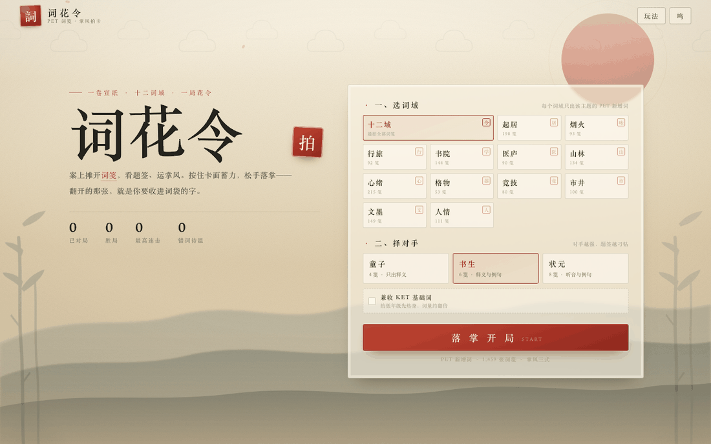
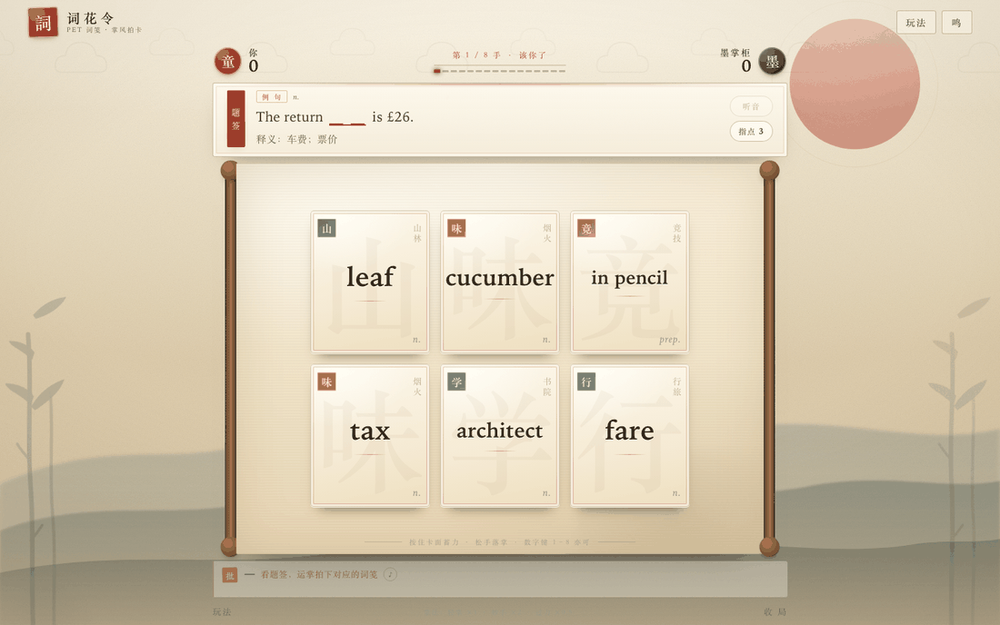
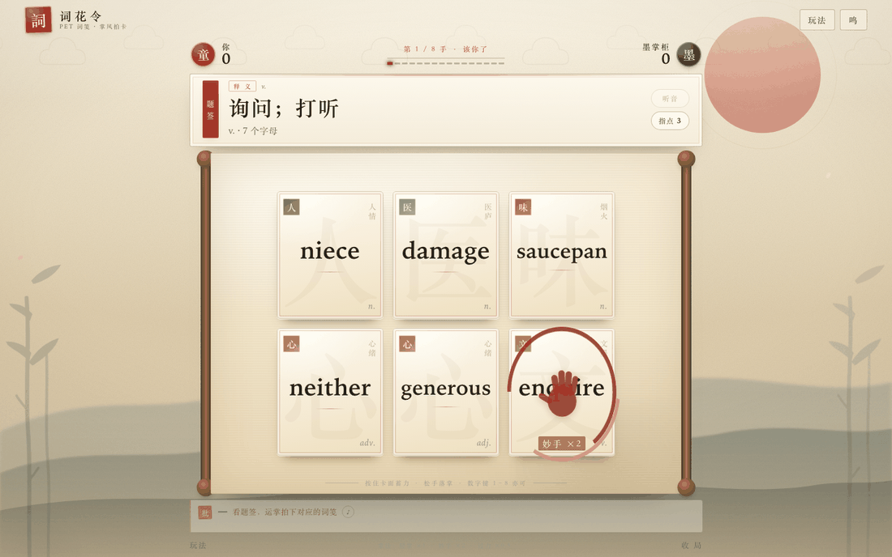
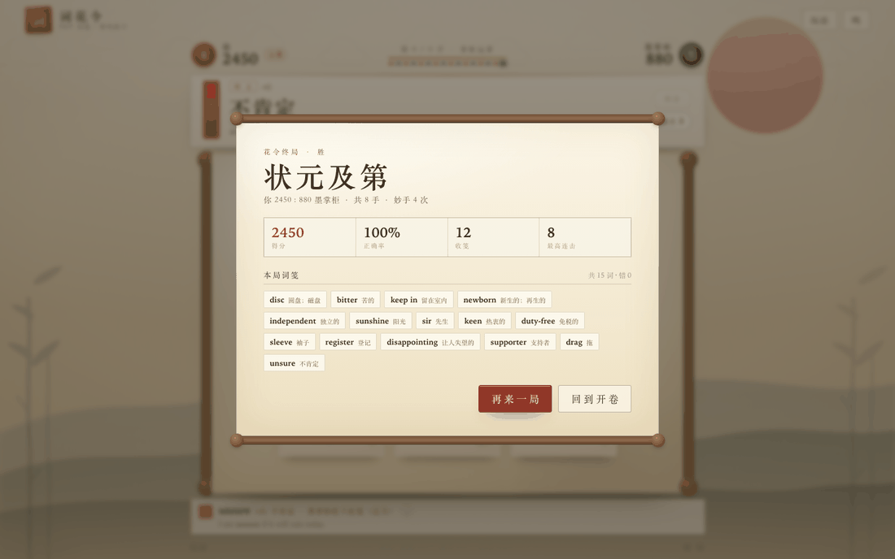
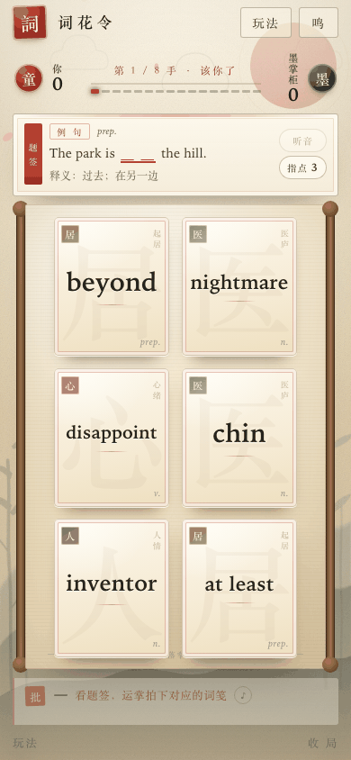

# 词花令 · PET 词笺掌风拍卡

把小朋友玩的「拍烟卡」搬进浏览器：案上摊开几张**词笺**，题签给出中文释义、例句挖空或读音，你按住卡面蓄力、松手落掌——掌风把卡笺翻面，正面是英文单词，背面是释义与例句。拍中了，词笺飞进你的词袋；拍错了，词笺归墨掌柜。

国风水墨 + 宣纸卷轴 + 朱砂印章 + 五声音阶；一局 3–6 分钟，可手机触屏玩。





| 蓄力 · 妙手 | 结算卷轴 | 手机竖屏 |
| --- | --- | --- |
|  |  |  |

## 一、词从哪里来

游戏直接读取本项目根目录的 `data/vocab.json`（由 `scripts/build_vocab.py` 生成），不另建词库。

| 环节 | 处理 |
| --- | --- |
| 取词 | 只取 `quiz === true` 的词条；**默认剔除 `ket` 基础词**，专注 PET 新增核心 |
| 清洗 | `zh` 按 `；` 拆义项、去词性前缀与英文说明，最多留 2 个义项；同一词域内去重（避免两张卡释义相同） |
| 过滤 | 去掉专有名词（首字母大写）、超长短语、无中文释义的词条 |
| 结果 | **1,459 张可用词笺**（勾选「兼收 KET 基础词」后 3,065 张） |
| 分域 | 沿用词库的 12 个 theme，换成国风名目（见下表）；选定词域后每题只出该域的卡，干扰项更「像」（选「十二域」则混排） |

| 词库 theme | 词花令词域 | 单字印 | 覆盖话题 |
| --- | --- | --- | --- |
| daily | 起居 | 居 | 家居 · 习惯 · 家务 |
| food | 烟火 | 味 | 饮食 · 口味 · 购物 |
| travel | 行旅 | 行 | 交通 · 住宿 · 行程 |
| school | 书院 | 学 | 学习 · 考试 · 职场 |
| health | 医庐 | 医 | 身体 · 疾病 · 治疗 |
| nature | 山林 | 山 | 环境 · 动物 · 气候 |
| feelings | 心绪 | 心 | 情绪 · 性格 · 态度 |
| tech | 格物 | 器 | 科技 · 网络 · 媒体 |
| sport | 竞技 | 竞 | 比赛 · 球类 · 户外 |
| city | 市井 | 市 | 城市 · 公共 · 社区 |
| culture | 文墨 | 文 | 艺术 · 音乐 · 文学 |
| people | 人情 | 人 | 家庭 · 关系 · 社交 |

词条字段全部用上：

- `w` → 卡面英文单词（按字母数自动缩字号，不拆词）
- `zh` / `pos` → 卡背释义、题签释义、词性
- `ex` → 卡背例句、例句挖空题（把目标词连同 `-s/-ed/-ing` 一起挖掉）
- `audio` → 单词英音（复用 `audio/` 里的原声；`听音辨词` 题直接播放）
- `theme` → 词域、卡面单字印、卡侧题跋

## 二、怎么玩

### 一手牌

1. 案上摊开 4 / 6 / 8 张词笺（取决于对手），全部正面朝上。
2. 题签出题：
   - **释义**：给中文，找英文卡（默认题）
   - **例句**：例句挖空，给中文提示，选词填空
   - **听音**：只放读音，看词找卡（状元档）
3. **按住你要拍的卡蓄力**，卡面浮出掌印与蓄力环；**松手落掌**。
4. 环上金色弧段是「妙手」：落在这里分数 ×2；轻掌 ×1；蓄满过力只记 ×0.5。
5. 拍中 → 词笺翻面、显出释义与例句、飞进你的词袋；**拍错 → 这张卡归对方，倒扣 30 分**。
6. 墨掌柜随后拍一手（它有固定命中率，掌法多半是轻掌或过力）。

### 花令

每逢双数手，你的回合会开出**花令**：该手分数双倍，书生档限时 10 秒、状元档 8 秒。
连击每 +1 分，得分再 ×(1 + 0.08×连击)，最高 ×1.8；拍错断连击。

### 三档对手

| 档位 | 案上词笺 | 题签 | 掌柜命中率 | 说明 |
| --- | --- | --- | --- | --- |
| 童子 | 4 张 | 释义为主 | 46% | 低年级热身 |
| 书生 | 6 张 | 释义 + 例句 | 66% | 默认，PET 主力练习 |
| 状元 | 8 张 | 例句 + 听音 | 84% | 花令限时 8 秒 |

双方各拍相同手数，**分数高者胜**。局末给出得分、正确率、收笺数、最高连击，以及本局出现的全部词笺（错词红标），点一下即可听音。

### 学习向的小设计

- **翻面即复习**：卡笺被掌风翻过来才看到释义和例句，翻面动作本身就是记忆点。
- **错词簿**：拍错的词记入 `localStorage`，下一局优先出现在牌堆前段，答对一次才消账。
- **朱批指点**：每局 3 次，圈出正确卡笺，代价是连击归零（不扣分）。
- **读音兜底**：优先播 `audio/` 里的英音；播放失败自动退回 SpeechSynthesis。

## 三、跑起来

```bash
cd pet-vocab-starship
python3 -m http.server 8000
# 打开 http://localhost:8000/ink-cards/
```

也可以从星舰首页「作战终端」底部的 **词花令 · 水墨拍卡** 入口进入。

> 必须用本地服务器打开：词库是 `fetch` 读取的，`file://` 会被浏览器拦。

## 四、文件

```
ink-cards/
├── index.html     页面骨架 + 掌印/竹/梅 SVG 图形库
├── style.css      宣纸、朱砂、卷轴、卡牌、蓄力环、响应式
├── js/
│   ├── data.js    词库读取 / 清洗 / 牌堆 / 题签生成
│   ├── fx.js      WebAudio 五声音阶音效 + Canvas 落花墨点粒子
│   └── game.js    回合、蓄力拍卡、计分、墨掌柜、结算、存档
└── docs/          预览图
```

无构建步骤、无外部依赖、无 CDN。音效全部用 WebAudio 合成（拨弦、编钟、木鱼、纸声、掌风），粒子用 Canvas 实时绘制，国风纹样全部为 CSS 渐变与内联 SVG（云纹、回纹、山形、掌印、竹、梅都是手绘路径；宣纸纤维用 `feTurbulence` 生成，不依赖任何图片素材）。

## 五、版权

词表、释义、例句与单词录音来自本项目的 Cambridge B1 Preliminary 词表与 Turtle Bay PET/KET 词卡（CC BY-NC 4.0），仅供非商业的个人学习使用。详见项目根目录 [ATTRIBUTION.md](../ATTRIBUTION.md)。
